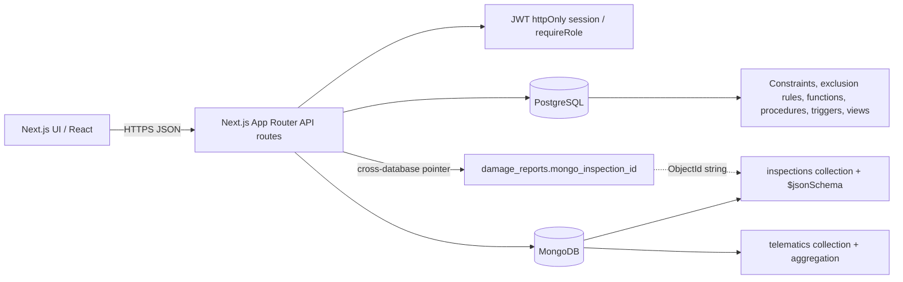

# FleetRent Architecture

## Request flow
1. The browser sends a request to a Next.js Route Handler.
2. Protected handlers call `requireRole()` to verify the signed JWT session and required application role.
3. Relational operations use the PostgreSQL pool in `lib/db.ts`; multi-step workflows use `withTransaction()`.
4. Inspection documents and telematics readings use MongoDB via `lib/mongo.ts`.
5. The return workflow creates an inspection document first, calls `sp_complete_return()` in PostgreSQL, and compensates by deleting the Mongo document if the PostgreSQL transaction fails.
6. `damage_reports.mongo_inspection_id` stores the MongoDB ObjectId as text. This is an application-managed cross-database reference, not a PostgreSQL foreign key.

## Database-level access control
`db/rbac.sql` (applied by `npm run db:init`) creates two roles, `fleet_admin` and `fleet_customer`.

- `fleet_admin` can do everything.
- `fleet_customer` can read vehicles and branches, and (through row-level security) only its own bookings, disputes and user row. It has no access to payments, maintenance logs or password hashes.

For each request, `withDbRole()` in `lib/db.ts` starts a transaction, switches to the matching role with `SET LOCAL ROLE`, and sets `app.current_user_id` from the verified session (never from request JSON). It is used for the booking history (`GET /api/bookings`), so even if the WHERE clause in that query were removed, the database would still hide other customers' bookings.

The other routes still run as the normal connection user and rely on `requireRole()`. Moving them behind RLS is possible but needs more grants (for example, the availability check has to see everyone's bookings, so it would need a SECURITY DEFINER function). That is listed as future work. `db/rbac-tests.sql` has 9 checks for the roles and policies.
